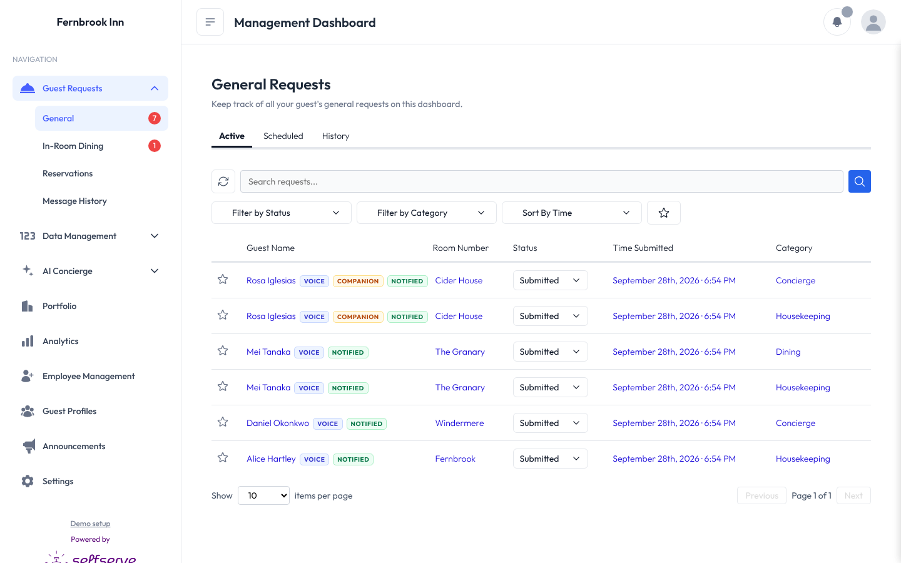
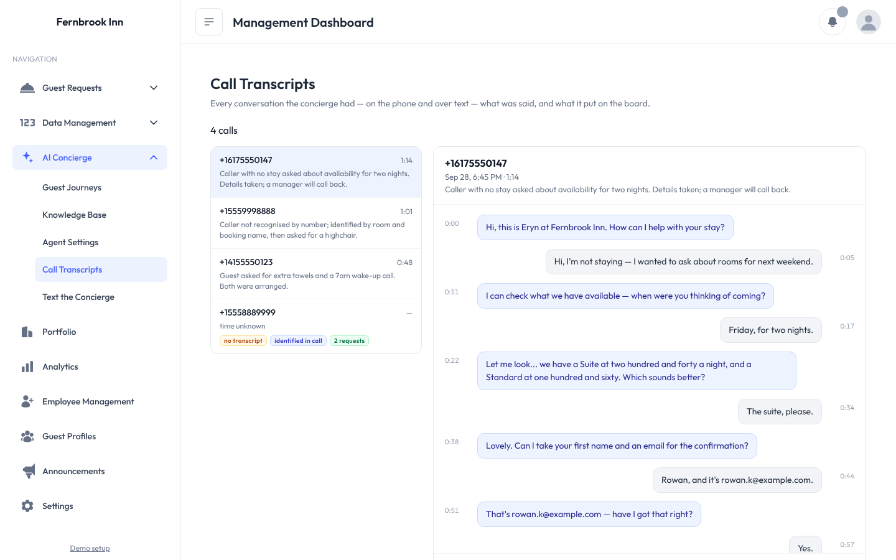

# Voice Concierge — operator dashboard

An AI phone concierge for boutique hotels. A guest rings the hotel's number, an
agent answers, and anything it agrees to — towels, a wake-up call, a room-service
order, a table booking — arrives on this dashboard as a real request, routed to the
right department and assigned to whoever is on duty.

**Live demo:** [demo.kushmallick.us](https://demo.kushmallick.us)

This repository is a static snapshot of the dashboard: twelve screens with real
captured data, running with no server, no build step and no network calls. Click
around it the way an innkeeper would.

> **Fernbrook Inn is invented.** Every property, guest, staff member, phone number
> and address in this demo is fictional. No real hotel or person is represented.

---

## What to look at

| Screen | What it shows |
|---|---|
| **Requests** | What arrived from phone calls, with the channel and identity chips |
| **Employees** | Who a request routes to, and the escalation chain behind them |
| **Call Transcripts** | What was actually said, turn by turn, with the tools the agent called |
| **Analytics** | Volume, deflection, staff hours and cost saved |
| **Portfolio** | The multi-property view, for an operator running several inns |
| **Text the Concierge** | The same agent over SMS, sharing one conversation loop |

## The parts that were actually hard

**Knowing who is on the phone.** Caller ID resolves most guests, but a partner or a
parent calling about a room booked in someone else's name resolves to nothing. That
caller can still name the room and the booking, which is what a front desk accepts —
so identity has three tiers, and what you can do narrows as confidence drops:

| Verified by | Towels, orders, wake-ups | The bill, private messages |
|---|---|---|
| The number on the reservation | yes | yes |
| Room + the name it's booked under | yes | no — handed to the team to call back |
| Room only, name didn't match | yes, flagged unverified | no |

The bottom tier exists because making someone prove who they are before they can ask
for a towel costs more than it protects. The request carries a flag so staff can see
it was never confirmed.

**Names as spoken, not as spelled.** A real call had a reservation under *Kushagra
Mallick* and a transcript reading *Kashagra Malik*. Exact matching refused a guest who
had answered correctly, twice. Names now match on edit distance inside a single room —
the room is what a stranger wouldn't know, so the candidate set stays small enough that
loose matching can't wander.

**Nothing is charged without being read back.** Anything that costs money returns a
computed total and waits: the agent has to call the tool a second time with
`confirmed: true` before a row is written, and the price is always recomputed
server-side rather than trusted from the model.

**Routing that a manager can see.** Every dispatch is recorded — who was texted, on
what number, whether it sent, simulated or failed. Mark someone away on the Employees
page and the next request moves down the chain.

## How this snapshot works

Every page of the real dashboard is a static HTML string server-side, with all data
fetched client-side from a handful of JSON endpoints. That made an export tractable:
capture the pages as they are, snapshot the endpoints, and replace `fetch` with a shim
that answers from the snapshot.

The shim reads an embedded object rather than fetching `api/*.json`, because Chromium
treats every `file://` document as an opaque origin and refuses `fetch` against it —
the first version failed silently on every page and rendered an empty board that looked,
at a glance, like a working export.

Writes are refused rather than faked. Changing a status answers *"Static export — there
is no server here, so nothing was saved."* A copy that appears to save and quietly loses
it is worse than one that tells you.

## Running it

Open `index.html`. That's the whole thing.

To host: drag this folder onto [Netlify Drop](https://app.netlify.com/drop), or connect
this repository — `netlify.toml` already marks it as a pre-built static publish.

## Built with

Node · TypeScript · Express · PostgreSQL · Drizzle · ElevenLabs Agents · Twilio
